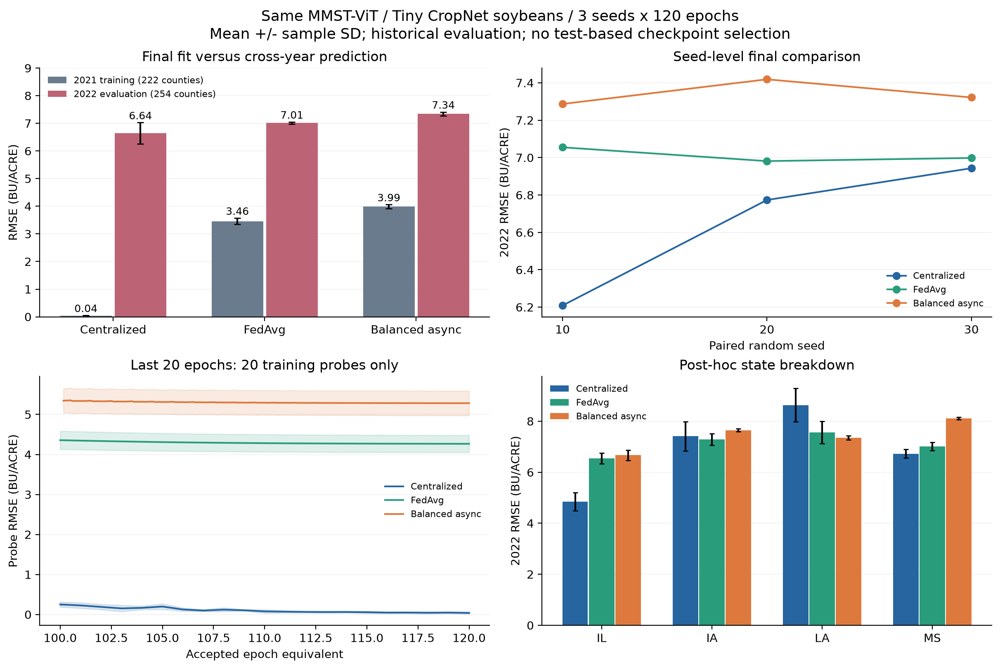

# CropNet-LEO-HAFL

同一 MMST-ViT 预测网络下，比较集中式训练、FedAvg 与平衡权重分层异步训练。仓库提供当前大豆预测实验的代码、固定配置、逐县预测结果和绘图入口，供合作研究与复核使用。

**当前实验：Tiny CropNet 大豆，2021 年训练、2022 年历史评估；3 个种子 × 3 种方法 × 120 轮。** 这是同模型训练方式的对比，不是 CropNet 原论文完整实验的复现。

## 已完成的结果

| 训练方法 | RMSE ↓（BU/ACRE） | 作者口径 R² = Corr² ↑ | Corr ↑ |
|---|---:|---:|---:|
| Centralized | 6.642 ± 0.384 | 0.652 | 0.808 |
| FedAvg | 7.011 ± 0.039 | 0.549 | 0.741 |
| Hierarchical async (balanced) | 7.342 ± 0.068 | 0.494 | 0.703 |

RMSE 为三种子的均值 ± 样本标准差；其他列为三种子均值。完整精度和标准差见 [结果表](examples/completed/evaluation/comparison.md)。三种方法共享每个种子的初始参数和数据协议，最终 120 轮模型统一评估；未按测试分数选择检查点。




联邦训练已能形成有效预测，但本次集中式效果最好；结果不证明异步精度更高，也不构成统计等效结论。三种子配对 RMSE 相对集中式的平均差距为 FedAvg +5.83%、平衡异步 +10.78%。

## 快速查看和重新出图

无需数据集、GPU 或模型权重：

```powershell
python -m pip install -r requirements-plots.txt
python scripts/reproduce_figures.py
```

程序先从 9 组逐县预测重新计算指标并核对记录，再将对比图和所有训练轮次的曲线写入 `artifacts/figures/`。训练曲线是每客户端抽取 1 个训练县的固定 20 县探针，**不是测试集随轮次曲线**。原实验没有保存每轮测试预测，不能从现有结果补出真实测试曲线。

## 重新训练

详细环境、下载、暂停续训与检查命令见 [复现实验](docs/REPRODUCING.md)。

```powershell
python -m research.joint_fusion.prepare_mmst_compare --plan
python -m research.joint_fusion.prepare_mmst_compare
.\start_mmst_compare.cmd
```

准备命令会下载固定版本的数据并检查两年的全部输入。长训练由监督进程管理；相同启动命令可续训。默认使用本仓库 `.venv` 中的 Python，也可显式指定解释器。

## 实现范围

- `research/joint_fusion/mmst_full_engine.py`：三种训练方法与异步事件推进。
- `research/joint_fusion/mmst_bridge.py`：固定版本的作者网络、输入接口及显存优化适配。
- `research/joint_fusion/run_mmst_compare.py`：配对训练、观测、最终评估与恢复。
- `research/joint_fusion/prepare_mmst_compare.py`：独立仓库的数据准备入口。
- `examples/completed/`：9 组逐县预测、训练日志和 2,169 个已提交探针观测点。
- `evidence/`：固定下载清单、原源码哈希和训练年诊断摘要。

当前按 IA、IL、LA、MS 四州分成 **4 个逻辑环，每环 5 个客户端，共 20 个客户端**。环内直接进行样本量加权平均，环间按逻辑到达事件异步更新。延迟 `[1.0, 1.2, 1.4, 1.6]` 是调度模型的逻辑量，不是实测卫星通信秒数。当前 MMST 对比结果尚未接入真实 Ring All Reduce、轨道链路传输或动态资源控制器；这些属于后续扩展。

本次仅使用作者提供的 Tiny 数据范围，采用随机初始化、无 SSL 预训练，与原论文完整训练条件不同。2022 年数据已被历史实验查看，应视为历史基准；后续确认性结论需要未查看的留出数据。

## 来源与发布说明

网络来自 [MMST-ViT](https://github.com/fudong03/MMST-ViT)，关联数据工作为 [CropNet](https://github.com/fudong03/CropNet)，数据来自 [Tiny-CropNet](https://huggingface.co/datasets/fudong03/Tiny-CropNet)。固定版本和授权信息见 [NOTICE](NOTICE.md)。

此共享版本增加了独立准备入口和相对路径启动方式；核心模型、聚合器、训练数值逻辑和已完成实验的数值结果保留不变。发布检查记录见 [验证说明](docs/VALIDATION.md)。原始影像、准备缓存、优化器状态和大型权重不随 Git 仓库分发。

English: Paired centralized, FedAvg and balanced hierarchical asynchronous training with the same MMST-ViT architecture on Tiny CropNet soybeans. Includes fixed protocol, per-county predictions and reproducible plots. The current experiment uses logical delays and does not claim physical satellite communication or dynamic resource-allocation results.
