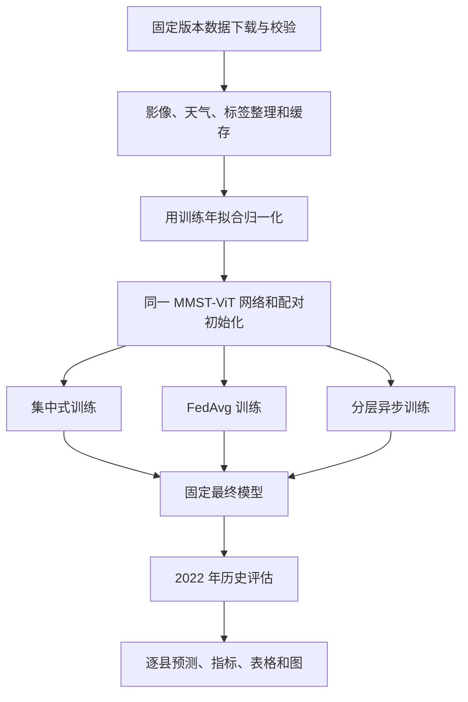

# 代码结构与功能说明

本文用于帮助合作人员理解仓库：各部分负责什么、三种算法在哪里实现、哪些文件是真实实验结果，以及当前实现到哪一步。

## 1. 项目整体在做什么

用同一个 MMST-ViT 多模态预测网络，分别采用集中式、FedAvg 和平衡权重分层异步三种训练方式，比较大豆产量预测效果。网络结合卫星影像、短期天气和长期天气；三种方法使用相同结构和每个种子配对的随机初始参数。

当前协议为 Tiny CropNet：2021 年 222 县训练，2022 年 254 县历史评估，种子 10/20/30，每种方法各 120 轮，共 9 组训练。联邦客户端与异步事件在单机上模拟。

训练过程中另行保存固定 20 个训练县的探针曲线，用于观察学习过程；它不属于上图最后的历史评估。

## 2. 顶层目录怎么看

| 目录或文件 | 作用 | 什么情况下查看 |
|---|---|---|
| [README.md](../README.md) | 项目总览、主要结果、快速入口和研究边界 | 第一次了解项目 |
| [research/joint_fusion/](../research/joint_fusion/) | 当前三算法实验的核心代码 | 理解或修改模型、数据和训练算法 |
| [cropnet_leo/](../cropnet_leo/) | 共享辅助模块；当前主流程使用 `remote.py` 的文件校验等功能 | 查下载与校验工具，不能将目录名称理解为已接入轨道控制 |
| [examples/completed/](../examples/completed/) | 已完成的九组实验记录 | 查看真实预测与训练过程 |
| [examples/analysis/](../examples/analysis/) | 事后结果汇总和诊断图 | 看训练拟合、跨年差距、分州与种子表现 |
| [scripts/](../scripts/) | 从已保存结果复核指标并重新出图 | 不重新训练，只看或绘制结果 |
| [evidence/](../evidence/) | 版本、哈希、前期诊断摘要和发布检查记录 | 追溯数据、代码及结果来源 |
| [tests/](../tests/) | 聚合流程、恢复、下载等短测试 | 检查程序行为是否被改坏 |
| [docs/](./) | 功能说明、复现步骤、验证说明 | 阅读操作和设计文档 |
| [requirements.txt](../requirements.txt) | 训练相关 Python 依赖；PyTorch 安装另见复现说明 | 建立训练环境 |
| [requirements-plots.txt](../requirements-plots.txt) | 仅重算指标、绘图所需依赖 | 只看结果，不训练 |
| [NOTICE.md](../NOTICE.md) | 原作者、固定版本、许可证和适配说明 | 了解代码归属与使用条件 |
| [.gitignore](../.gitignore) | 排除数据、权重、缓存和本机文件 | 理解哪些生成文件没有上传 |
| [.gitattributes](../.gitattributes) | 保持已归档文件的原始字节，避免换行转换影响哈希 | 核对跨平台文件校验行为 |

运行后本机会生成 `data/`、`results/`、`artifacts/`，它们被 Git 忽略。`examples/` 是随仓库提供的历史结果；`results/` 是新训练输出，二者分开保存。

## 3. 数据与预测模型

以下文件均位于 [research/joint_fusion/](../research/joint_fusion/)。

| 文件 | 负责的功能 |
|---|---|
| [prepare_mmst_compare.py](../research/joint_fusion/prepare_mmst_compare.py) | 新电脑的数据准备入口：核验清单、下载、准备训练与评估缓存，并在长训练前检查全部输入。无需原机器的旧校准目录。 |
| [download_mmst_data.py](../research/joint_fusion/download_mmst_data.py) | 固定版本下载清单、分段下载、续传和内容校验。 |
| [mmst_data.py](../research/joint_fusion/mmst_data.py) | 读取县列表，为每个县匹配影像、天气、产量标签，按州划分客户端。 |
| [mmst_full_data.py](../research/joint_fusion/mmst_full_data.py) | 保存紧凑的县级输入缓存；读取缓存；仅用训练数据拟合天气和目标的归一化统计。 |
| [author_protocol/](../research/joint_fusion/author_protocol/) | 保存固定版本的作者网络源码、许可证和县列表。 |
| [mmst_bridge.py](../research/joint_fusion/mmst_bridge.py) | 建立作者 MMST-ViT 网络并接到本项目；处理单样本批维度问题，使用激活检查点降低训练显存。 |
| [verify_mmst_model.py](../research/joint_fusion/verify_mmst_model.py) | 用合成输入检查真实网络的前向、反向和参数更新，不产生农业性能结论。 |

当前模型采用随机初始化，没有使用原论文的 SSL 预训练。网络内部输出两个目标通道；对外报告的是恢复为 BU/ACRE 单位后的大豆单产预测指标。

## 4. 三种算法如何训练

主实现是 [mmst_full_engine.py](../research/joint_fusion/mmst_full_engine.py)，聚合公式集中在 [aggregation.py](../research/joint_fusion/aggregation.py)。

| 方法 | 一轮或一次更新做什么 | 通俗理解 |
|---|---|---|
| Centralized | 将全部训练县打乱，按批次更新同一个模型 | 一位学习者看所有训练数据 |
| FedAvg | 所有客户端从当前全局参数开始，各自完成本地更新，再按客户端样本数加权平均 | 大家各学一遍，等齐后统一汇总 |
| Hierarchical async (balanced) | 同环客户端从同一份参数开始训练，先做环内加权平均；各环的结果按逻辑到达顺序更新全局模型 | 先分组汇总，哪个组的结果到达就处理哪个组 |

当前按四州组成 4 个逻辑环，每环 5 个客户端。异步更新合入的是“环内训练后参数减去该环起点参数”的变化量。更新强度还乘以该环样本占比及固定平衡系数；当前陈旧度指数为 0，即记录陈旧度但不额外按陈旧度衰减，最大环领先量限制为 2。

三算法的训练样本预算相同，但优化器步数、聚合次数和运行时间不同，因此不属于等时间或等计算量比较。每个环完成 120 次本地训练，在当前四环设置下异步共接收 480 次环更新；图中的横轴按已接收县样本量换算为 120 个训练轮次等价预算。

| 支撑模块 | 作用 |
|---|---|
| [mmst_training.py](../research/joint_fusion/mmst_training.py) | 随机种子、参数向量读写和优化器构造等基础工具。 |
| [mmst_async_annealed.py](../research/joint_fusion/mmst_async_annealed.py) | 当前引擎调用其中的学习率日程：预热、固定阶段及后续衰减。 |
| [mmst_optimizer_store.py](../research/joint_fusion/mmst_optimizer_store.py) | 保存各客户端自己的优化器状态，训练时读取，并配合恢复检查点持久化。 |
| [configs/mmst_compare_balanced_v1.json](../research/joint_fusion/configs/mmst_compare_balanced_v1.json) | 固定三种子、120 轮、模型尺寸、学习率、客户端数、逻辑延迟和异步平衡系数。 |

## 5. 谁负责启动、暂停和恢复

[run_mmst_compare.py](../research/joint_fusion/run_mmst_compare.py) 是当前正式比较的协调入口。它负责准备就绪检查、源码快照、三算法配对训练、探针观测和训练结束后的统一评价，并调用底层训练模块。

| 文件 | 作用 |
|---|---|
| [start_mmst_compare.cmd](../start_mmst_compare.cmd) | Windows 开始或恢复训练。首次运行前须按复现文档完成环境与数据准备。 |
| [pause_mmst_compare.cmd](../pause_mmst_compare.cmd) | 写入暂停请求；等训练保存到可恢复边界并显示 `PAUSED` 后再关闭窗口。 |
| [plot_mmst_compare.cmd](../plot_mmst_compare.cmd) | 为本地运行输出重新生成训练探针曲线；查看仓库自带结果优先用下文 `reproduce_figures.py`。 |
| [download_mmst_compare_eval.cmd](../download_mmst_compare_eval.cmd) | 保留的原始输入下载操作入口；新电脑优先使用完整的 `prepare_mmst_compare.py` 准备流程。 |
| [run_mmst_compare.ps1](../run_mmst_compare.ps1) | Windows 启动包装：选择 Python、记录日志，转发运行、状态、暂停等操作。 |
| [supervise_mmst_compare.py](../research/joint_fusion/supervise_mmst_compare.py) | 管理训练子进程，限制重复启动，对可恢复故障最多自动重启 3 次。 |
| [mmst_compare_runtime.py](../research/joint_fusion/mmst_compare_runtime.py) | 容量检查、下载重试、输入扫描和错误分类。 |
| [mmst_compare_recovery.py](../research/joint_fusion/mmst_compare_recovery.py) | 将超出已保存检查点的探针记录另行归档，避免恢复后重复计入曲线。 |
| [mmst_io.py](../research/joint_fusion/mmst_io.py) | JSON 和进度文件的写入工具。 |

`run_mmst_local.py`、`run_mmst_full_repaired.py` 等早期入口仍被当前程序复用部分训练和恢复函数；`run_mmst_calibration.py`、`mmst_repair*.py` 等文件还承担历史校准或辅助功能。它们随依赖和源码追溯保留，**不需要逐个启动**。新复现统一按照 [REPRODUCING.md](REPRODUCING.md) 的当前入口操作。

## 6. 指标、曲线与结果文件

[author_evaluation.py](../research/joint_fusion/author_evaluation.py) 计算 RMSE、Pearson Corr、作者口径的 Corr²，以及标准决定系数 `1-SSE/SST`。两种 R² 分开命名，避免混用。[plot_mmst_compare.py](../research/joint_fusion/plot_mmst_compare.py) 绘制比较图、散点图、结果表和训练过程曲线。

| 结果位置 | 内容与用途 |
|---|---|
| [examples/completed/evaluation/](../examples/completed/evaluation/) | 九组最终模型的 2022 年逐县预测与指标，共 2,286 条预测；包含比较表、散点图和三算法对比图。 |
| [examples/completed/training/](../examples/completed/training/) | 训练事件日志、客户端划分、归一化信息、完成结果和恢复元数据；模型与优化器大文件本体不在仓库中。 |
| [examples/completed/curves/](../examples/completed/curves/) | 三种子共 2,169 个已提交探针观测点，保存指标、预测和校验信息。 |
| [examples/analysis/](../examples/analysis/) | 基于最终预测的描述性分析和诊断图；不代表新训练或测试调参。 |
| [scripts/reproduce_figures.py](../scripts/reproduce_figures.py) | 从上述历史记录重新核算指标和图表，无需原始数据、模型权重或 GPU。 |

曲线中的 20 个探针县来自训练集，每客户端选 1 县。它们用于观察训练变化，不能称为验证集或测试集曲线。2022 年只保存了最终评价，原实验没有完整的逐轮测试预测。

仅复核和出图的命令见 [README](../README.md#快速查看和重新出图)；完整安装、训练与恢复步骤见 [REPRODUCING.md](REPRODUCING.md)。

## 7. 如何核对结果可信度

[evidence/](../evidence/) 保存固定数据下载清单、原实验源码 SHA-256、共享版本文件清单、训练年异步短诊断摘要和真实网络接口检查报告。它帮助区分作者源码、本项目适配和已经产生的结果。

[tests/](../tests/) 检查下载中断恢复、参数与文件校验、暂停续训、九组执行流程等。已通过的检查及其范围见 [VALIDATION.md](VALIDATION.md)。短测试使用小型合成网络；真实网络接口检查使用合成输入，两者均不替代农业预测实验。

## 8. 当前功能边界

当前已实现同网络的三种训练方法、逻辑环异步更新、配对种子、恢复、固定最终历史评价和结果复核。当前 MMST 对比没有实现实际的环形分块传输与 Ring All Reduce，没有接入真实轨道可见性、链路容量、通信能耗或动态资源配置控制器。

因此，已有结果可用于讨论联邦预测能力及相对集中式的精度差距，不能用于证明卫星通信节省、资源优化收益或异步精度优于 FedAvg。后续研究这些功能时应单独建立配置与实验结果，不覆盖本次对比。
