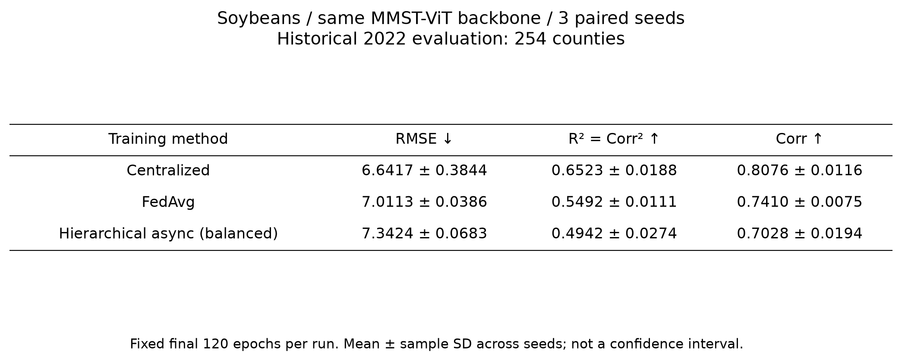
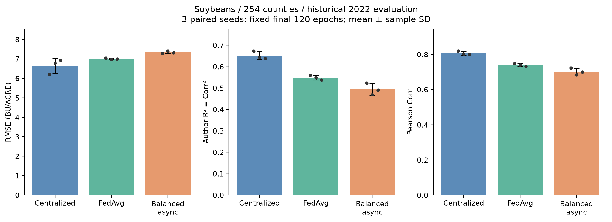
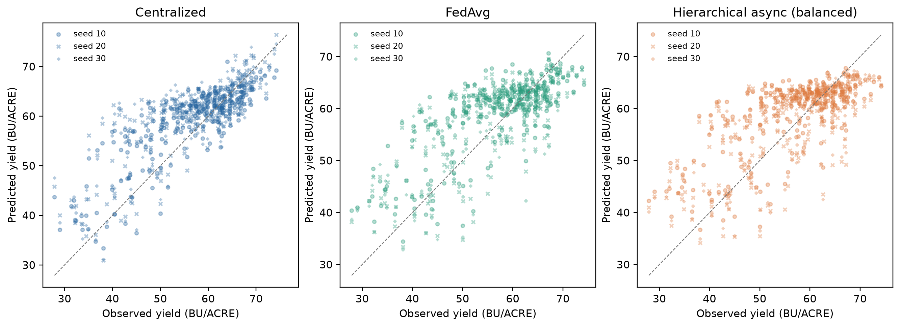

# 三种子三算法大豆对比

种子 [10, 20, 30]；每组固定最终120轮；2022年254县历史基准复测。表内为逐种子指标的均值±样本标准差（ddof=1）。

|训练方式|RMSE↓|作者R²=Corr²↑|Corr↑|标准决定系数|同种子RMSE相对集中式差距（%）|
|---|---:|---:|---:|---:|---:|
|Centralized|6.6417 ± 0.3844|0.6523 ± 0.0188|0.8076 ± 0.0116|0.5547 ± 0.0508|0.0000 ± 0.0000|
|FedAvg|7.0113 ± 0.0386|0.5492 ± 0.0111|0.7410 ± 0.0075|0.5049 ± 0.0055|5.8295 ± 6.8494|
|Hierarchical async (balanced)|7.3424 ± 0.0683|0.4942 ± 0.0274|0.7028 ± 0.0194|0.4570 ± 0.0101|10.7824 ± 6.0530|

R²按作者公开指标实现取Corr²；另列标准决定系数。全部分数来自相同评价县及固定最终模型，没有按测试结果挑选轮次。
误差线是三个种子的样本标准差，不是置信区间。相同训练样本处理量不等于相同优化步数、时间或通信开销。
训练过程曲线是固定训练探针，不能当验证或测试曲线。本轮为Tiny CropNet大豆比较，不是原论文四作物主表复现，也不预设三种方法精度相等。
